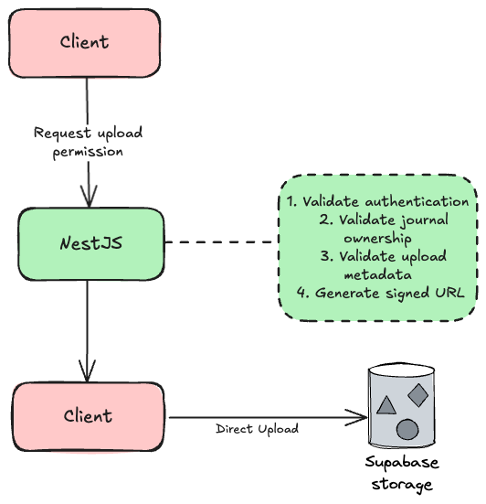
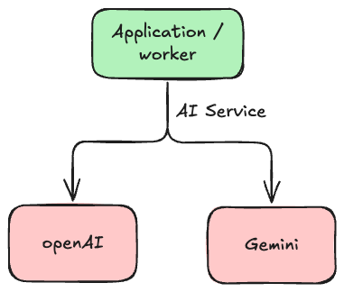
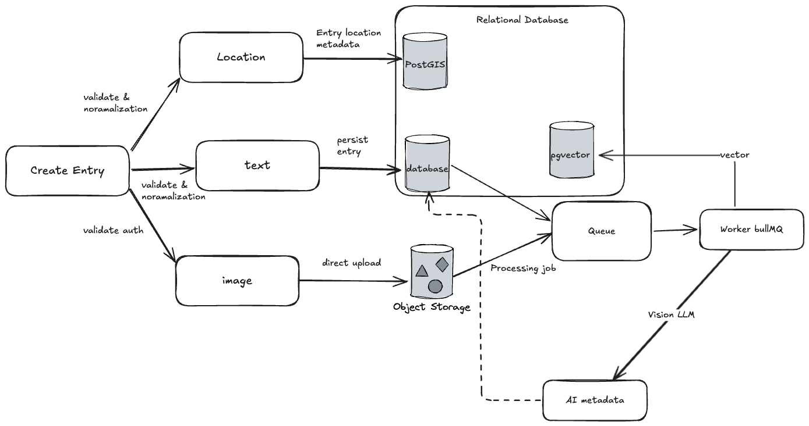
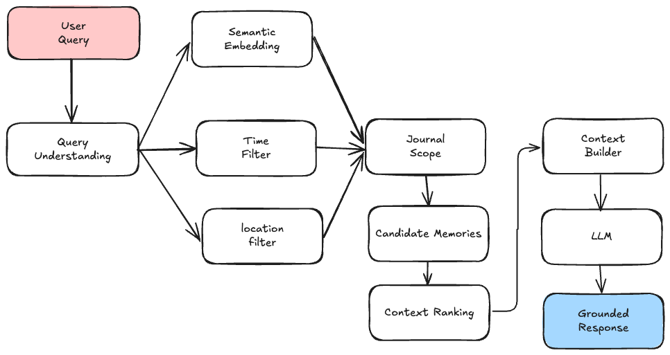

# JournalPilot — System Architecture

**Project:** JournalPilot  
**Document:** System Architecture  
**Version:** 1.0  
**Status:** Approved
**Date:** September 2026  
**Author:** Kevin Pratama

---

## 1. Architecture Overview

JournalPilot is a multi-tenant, AI-augmented digital journal that transforms personal journal entries into a searchable and conversational personal memory system.

The architecture is designed around four core capabilities:

1. **Reliable journal storage** for text, images, timestamps, and locations.
2. **Asynchronous multimodal processing** for embeddings and image understanding.
3. **Hybrid RAG** combining semantic, temporal, geospatial, and journal-scope retrieval.
4. **Evidence-grounded AI** that generates answers and weekly reflections from the user's authorized memories.

---

# 2. Architecture Goals & Principles

## 2.1 Privacy First

Journal entries are private personal data. Every data access path must be scoped to the authenticated user and authorized journals.

Principles:

- Journal data is private by default.
- Users can only access their own journals and entries.
- AI processing must only receive authorized user data.
- Media access should use controlled storage access.
- Deleted data must eventually be permanently removed.

## 2.2 Asynchronous AI Processing

AI operations such as image analysis and embedding generation should not block normal CRUD operations.

Instead:

```text
User saves entry
      ↓
Entry stored immediately
      ↓
Processing job queued
      ↓
Background worker
      ↓
Embedding / vision processing
      ↓
Memory becomes searchable
```

This keeps normal journal interactions responsive and allows background workloads to be retried independently.

## 2.3 Context-Aware Retrieval

JournalPilot does not treat every memory as a simple text-search result.

Retrieval should consider:

- Semantic similarity
- Time
- Location
- Journal scope
- Conversation context

This enables queries such as:

> "What happened when I was in South Tangerang last month?"

instead of only matching keywords.

## 2.4 Evidence-Grounded AI

The LLM should generate responses from retrieved journal memories rather than treating the model's general knowledge as a source of personal facts.

The RAG pipeline should therefore follow:

```text
User Query
   ↓
Query Understanding
   ↓
Memory Retrieval
   ↓
Context Construction
   ↓
LLM
   ↓
Grounded Response
```

## 2.5 Independent Workload Scaling

API requests and AI processing have different workload characteristics.

The architecture therefore separates:

- Synchronous API traffic
- Background processing
- Database operations
- Object storage
- AI provider requests

This allows the expensive AI workload to scale independently when necessary.

## 2.6 Avoid Unnecessary Infrastructure

JournalPilot is initially developed by a solo developer. Infrastructure should only be introduced when it solves a real product or engineering requirement.

The architecture therefore uses a modular application and managed services instead of prematurely splitting the system into many microservices.

---

# 3. System Context

## 3.1 External Actors

### User

The user interacts with JournalPilot through the web application to:

- Create and manage journals.
- Write and edit entries.
- Attach images.
- Attach locations.
- Browse timeline and calendar views.
- Search memories.
- Ask questions through conversational RAG.
- Receive weekly reflections.

### Authentication Provider

Supabase Auth manages authentication and identity-related functionality such as:

- Sign up
- Login
- Google OAuth
- Password reset
- Session management

### AI Provider

An external AI provider such as OpenAI or Gemini provides capabilities such as:

- Text embedding generation
- Vision/image understanding
- Language generation

The application should interact with AI providers through an internal AI abstraction rather than coupling business logic directly to one provider.

### Object Storage

Supabase Storage stores journal media such as images.

### Application Database

PostgreSQL stores application data, metadata, relationships, embeddings, and geospatial information.

---

# 4. High-Level Architecture

JournalPilot is organized into the following major components:


The diagram intentionally separates **media transfer** from the API path. NestJS authorizes the upload and generates a short-lived signed URL; the browser uploads the image directly to storage instead of sending large binary payloads through the NestJS server.

---

# 5. Application Architecture

## 5.1 Frontend — Next.js

The Next.js application provides the user-facing web experience.

Responsibilities include:

- Authentication UI
- Journal management UI
- Entry editor
- Image selection and upload
- Location selection
- Timeline
- Calendar
- Statistics
- Places/map view
- AI chat interface
- Weekly reflection interface
- Processing status display

The browser communicates with the NestJS API for application operations.

For media uploads, the browser uses a signed upload URL to upload directly to Supabase Storage.

## 5.2 Backend API — NestJS

NestJS acts as the main application backend and business-logic boundary.

Responsibilities include:

- Authentication/session validation
- Authorization
- Journal CRUD
- Entry CRUD
- Media upload authorization
- Signed upload URL generation
- Location metadata management
- Search
- RAG orchestration
- Conversation management
- Statistics
- Trash/recovery
- Queue job creation
- Weekly reflection scheduling/orchestration

NestJS should not handle large image binaries during normal uploads.

Instead:



## 5.3 Background Workers

Background workers process operations that do not need to block the user's request.

Example jobs:

- Generate text embeddings
- Analyze images with a Vision LLM
- Generate image descriptions/tags
- Generate image embeddings when required
- Update memory indexes
- Process failed AI jobs
- Generate weekly reflections
- Clean up permanently deleted data

## 5.4 AI Services

AI functionality should be isolated behind an internal provider abstraction.

Conceptually:



The rest of the application should not depend directly on provider-specific SDK calls.

This makes it easier to:

- Change providers.
- Compare models.
- Control AI costs.
- Test AI functionality.
- Introduce provider fallbacks later if required.

---

# 6. Data Architecture

## 6.1 PostgreSQL

PostgreSQL is the primary relational database.

It stores:

- Users / tenant relationships
- Journals
- Entries
- Media metadata
- Conversations
- Messages
- AI processing state
- Embeddings
- Location metadata
- Timestamps
- Trash/deletion state

PostgreSQL is selected as the central data store because JournalPilot needs relational data, vector search, and geospatial querying in one database system.

## 6.2 pgvector

pgvector stores and searches vector embeddings associated with journal memories.

Primary use:

```text
Journal text / multimodal representation
             ↓
        Embedding Model
             ↓
          Vector
             ↓
          pgvector
             ↓
      Similarity Search
```

Semantic retrieval uses vector similarity to identify memories that are conceptually relevant to a query, even when the query does not contain the exact words used in the original journal entry.

## 6.3 PostGIS

PostGIS stores and queries geographic information.

Location data can support queries such as:

- Entries in a specific city
- Entries near a coordinate
- Memories associated with a place
- Location-based journal feeds

Conceptually:

```text
GPS coordinates
      ↓
PostGIS geometry/geography
      ↓
Spatial query
      ↓
Relevant journal entries
```

## 6.4 Supabase Storage

Supabase Storage stores journal media separately from relational metadata.

The database stores media metadata and a reference/path to the object rather than storing the raw image binary inside PostgreSQL.

Example:

```text
PostgreSQL
┌─────────────────────────┐
│ media                   │
│ ├─ id                   │
│ ├─ entry_id             │
│ ├─ storage_path         │
│ ├─ mime_type            │
│ └─ processing_status    │
└─────────────────────────┘

Supabase Storage
┌─────────────────────────┐
│ /user/journal/image.jpg │
└─────────────────────────┘
```

## 6.5 Redis

Redis is used as the infrastructure for asynchronous job processing through BullMQ.

It should not become the source of truth for journal data.

PostgreSQL remains the authoritative application data store.

---

# 7. Authentication & Multi-Tenancy

JournalPilot is a multi-tenant system where each user's journals and memories must be isolated from other users.

## 7.1 Authentication

Supabase Auth manages authentication and sessions.

The client authenticates the user and sends the appropriate authenticated request to NestJS.

NestJS validates the authentication context before accessing protected resources.

## 7.2 Authorization

Authorization must be enforced at the backend/data-access boundary.

For example:

```text
Request
  ↓
Authenticated User
  ↓
NestJS
  ↓
Resolve user identity from auth context
  ↓
Check journal ownership
  ↓
Access journal/entry
```

The server should not trust an arbitrary `user_id` supplied by the client to determine whose data can be accessed.

## 7.3 Tenant Isolation

Every user-owned query must be scoped to the authenticated user.

For example:

```text
SELECT entries
WHERE user_id = authenticated_user_id
AND journal_id = authorized_journal_id
```

The same rule applies to RAG retrieval.

A semantic match from another user's journal must never be returned as context.

---

# 8. Journal Ingestion Architecture

JournalPilot treats an entry as more than plain text. A memory can contain:

- Text
- Images
- Timestamp
- Location
- Journal association
- AI-generated representations

## 8.1 Text Ingestion

```text
Journal Text
    ↓
Validate / normalize
    ↓
Persist entry
    ↓
Queue embedding job
    ↓
Embedding model
    ↓
Store vector in pgvector
```

## 8.2 Image Ingestion

Images use direct-to-storage upload.

```text
1. Client selects image
        ↓
2. Client requests signed upload URL
        ↓
3. NestJS validates authorization
        ↓
4. NestJS returns signed URL
        ↓
5. Client uploads directly to Supabase Storage
        ↓
6. Client / API creates media metadata record
        ↓
7. Processing job is queued
        ↓
8. Worker retrieves image
        ↓
9. Vision LLM analyzes image
        ↓
10. Result stored as searchable metadata
```

This prevents the NestJS API from becoming a bandwidth bottleneck for large image uploads.

## 8.3 Location Ingestion

Location data is stored as geospatial metadata associated with the journal entry.

```text
Client Location
      ↓
Validate / normalize
      ↓
Entry location metadata
      ↓
PostGIS
```

Location tagging is optional because users may choose not to provide location information.

## 8.4 Complete Ingestion Pipeline



The original journal entry should remain usable even if AI processing fails. AI processing is an enhancement to the stored memory, not a prerequisite for saving the user's journal data.

---

# 9. RAG Architecture

Hybrid RAG is a core MVP capability and therefore the most important AI architecture component.

## 9.1 Query Processing

The RAG request begins with a natural-language question.

```text
User Question
      ↓
NestJS RAG Orchestrator
      ↓
Query Understanding
      ↓
Extract retrieval constraints
      ↓
Hybrid Retrieval
      ↓
Context Construction
      ↓
LLM Generation
      ↓
Grounded Answer
```

## 9.2 Query Scope

Before retrieval, the system establishes the scope of the query.

Possible dimensions:

- Authenticated user
- Selected journal(s)
- Time range
- Location
- Semantic meaning
- Conversation context

The authenticated user's scope is mandatory.

## 9.3 Semantic Retrieval

Semantic retrieval converts the user's query into an embedding and searches pgvector for relevant memories.

```text
Query
 ↓
Embedding Model
 ↓
Query Vector
 ↓
pgvector similarity search
 ↓
Candidate memories
```

## 9.4 Temporal Retrieval

Temporal constraints are extracted from the query when present.

Examples:

- "last week"
- "last month"
- "during September"
- "before my internship"

These constraints are converted into a time range or relevant temporal condition before or during retrieval.

Example:

```text
"What happened last month?"
          ↓
     Time constraint
          ↓
  Start date / End date
          ↓
Filter candidate memories
```

## 9.5 Geospatial Retrieval

Location constraints are resolved into geospatial conditions.

Examples:

- "when I was in South Tangerang"
- "entries near my university"
- "what happened at this place?"

The system can use PostGIS to filter entries based on coordinates, regions, or distance.

## 9.6 Hybrid Retrieval

JournalPilot combines multiple retrieval dimensions rather than relying on semantic similarity alone.



The goal is to reduce irrelevant memories before they reach the LLM.

## 9.7 Context Construction

Retrieved memories are transformed into a structured context for the LLM.

The context can include:

- Entry text
- Entry date/time
- Journal name
- Location metadata
- Relevant image descriptions
- Relevant media metadata
- Retrieval relevance information

Only authorized memories should be included.

The context should be bounded to prevent excessive token usage and unnecessary AI cost.

## 9.8 LLM Response Generation

The LLM receives:

1. System instructions.
2. The user's question.
3. Conversation context when applicable.
4. Retrieved journal memories.

The response should be grounded in the supplied memories.

If the retrieved memories do not contain enough evidence, the system should communicate that the available journal data is insufficient rather than inventing a personal memory.

---

# 10. Conversational Memory

JournalPilot supports follow-up questions that depend on previous questions and answers.

Example:

```text
User:
"What were my biggest challenges last month?"

        ↓

Assistant:
[Retrieved memories]

        ↓

User:
"Was it worse when I worked from home?"

        ↓

Query + conversation context
        ↓

Hybrid retrieval
        ↓

Grounded answer
```

Conversation history should provide **query context**, but it must not override tenant or journal authorization rules.

A follow-up query still operates within the authenticated user's permitted memory scope.

---

# 11. Weekly Reflection Architecture

Weekly reflection is an asynchronous scheduled workflow.

## 11.1 Scheduling

A scheduled job runs every Sunday or according to the user's configured weekly schedule.

```text
Scheduler
   ↓
Weekly Reflection Job
   ↓
For each eligible user
   ↓
Retrieve previous 7 days
   ↓
Analyze journal evidence
   ↓
Generate reflection
   ↓
Persist result
```

## 11.2 Data Retrieval

The system retrieves the user's journal entries from the previous seven-day period.

The retrieval must remain scoped to the authenticated user's data.

## 11.3 Analysis

The reflection may identify:

- Recurring themes
- Notable events
- Productivity patterns
- Positive accomplishments
- Challenges
- Changes compared with previous periods

These are treated as **personal reflection insights**, not clinical psychological assessments.

## 11.4 Grounding

The generated reflection must be grounded in retrieved journal entries.

The AI should not present unsupported speculation as fact.

## 11.5 Failure Handling

A failed weekly reflection should not affect the underlying journal data.

The job can be retried through BullMQ, while the user can be shown a processing or failure state when appropriate.

---

# 12. Asynchronous Processing & Job Architecture

Redis and BullMQ handle background processing.

## 12.1 Job Flow

```text
NestJS API
    │
    │ Add job
    ▼
BullMQ Queue
    │
    │ Redis
    ▼
Background Worker
    │
    ├── Text Embedding
    ├── Image Analysis
    ├── Memory Indexing
    └── Weekly Reflection
```

## 12.2 Example Job Lifecycle

```text
QUEUED
  ↓
PROCESSING
  ↓
COMPLETED
```

Failure:

```text
QUEUED
  ↓
PROCESSING
  ↓
FAILED
  ↓
RETRY
  ↓
PROCESSING
```

A persistent processing status should be available where the UI needs to communicate the state of AI processing.

## 12.3 Why Background Jobs

Background jobs are appropriate for work that is:

- Slow
- External-provider dependent
- Retryable
- CPU/network intensive
- Not required to complete the user's immediate request

Examples include image analysis, embedding generation, and weekly reflection generation.

---

# 13. Security & Privacy Architecture

## 13.1 Authentication Security

- Authentication is handled through Supabase Auth.
- Protected API endpoints require a valid authenticated session.
- NestJS validates authentication before accessing user data.

## 13.2 Authorization

Authorization is enforced for every user-owned resource.

```text
Authenticated User
       ↓
Resource Request
       ↓
Ownership / Permission Check
       ↓
Authorized Access
```

## 13.3 RAG Security

RAG retrieval is subject to the same authorization rules as normal application queries.

The vector database must never be treated as a globally searchable memory pool.

Conceptually:

```text
Vector Search
     ↓
User Scope Filter
     ↓
Journal Scope Filter
     ↓
Time / Location Filters
     ↓
Relevant Memories
```

## 13.4 Media Security

Images should not require publicly exposed storage URLs when private access is intended.

The application should use controlled access mechanisms such as signed upload/download URLs where appropriate.

## 13.5 Data Deletion

Trash/recovery provides a temporary deletion state.

Permanent deletion should remove the relevant application data and associated media/AI artifacts according to the retention rules defined by the product.

---

# 14. Reliability & Failure Handling

The system should separate user data persistence from optional AI processing.

## 14.1 Entry Save Failure

If the database transaction fails, the entry should not be considered successfully saved.

## 14.2 AI Processing Failure

If AI processing fails after the entry is saved:

```text
Entry saved successfully
        │
        ▼
AI job fails
        │
        ├── Entry remains available
        ├── Processing status = FAILED
        └── Job can be retried
```

The failure should not corrupt the original journal entry.

## 14.3 AI Provider Failure

AI provider failures should be isolated behind the AI service layer.

Possible handling includes:

- Retry transient failures.
- Record failure state.
- Avoid infinite retries.
- Surface an appropriate status to the user.
- Allow provider/model changes without rewriting core journal logic.

## 14.4 Storage Failure

If media upload succeeds but metadata creation fails, the system should provide a way to reconcile or clean up orphaned objects.

If metadata is created but the upload fails, the media record should reflect the failed/incomplete state rather than pretending the image is available.

---

# 15. Scalability Strategy

JournalPilot does not initially require a microservice architecture.

The initial system can scale by separating workloads where necessary.

## 15.1 Initial Stage

```text
Next.js
   ↓
NestJS
   ↓
PostgreSQL
   +
Redis / BullMQ
   +
Supabase Storage
```

## 15.2 Growth Stage

As usage increases, API and worker workloads can scale independently.

```text
                  ┌── API Instance 1
Load Balancer ────┼── API Instance 2
                  └── API Instance N
                          │
                          ▼
                     PostgreSQL

                  ┌── Worker 1
BullMQ ───────────┼── Worker 2
                  └── Worker N
```

This separation is sufficient for the initial product without introducing unnecessary distributed-system complexity.

## 15.3 AI Cost Scalability

AI cost should be controlled through:

- Asynchronous processing
- Bounded RAG context
- Appropriate embedding models
- Avoiding unnecessary repeated processing
- Caching where useful
- Model/provider abstraction

---

# 16. Observability

Observability should focus on the areas most likely to fail or become expensive.

## 16.1 Application Metrics

Track:

- API response latency
- Error rates
- Database errors
- Authentication failures

## 16.2 Background Job Metrics

Track:

- Queue depth
- Processing duration
- Success/failure count
- Retry count
- Failed jobs

## 16.3 AI Metrics

Track:

- AI provider latency
- Token usage where available
- Estimated cost
- Model used
- Embedding processing time
- Vision processing failures

## 16.4 RAG Metrics

The project should eventually evaluate:

- Retrieval relevance
- Temporal constraint accuracy
- Geospatial constraint accuracy
- Groundedness
- Hallucinated memories
- Response quality

These metrics are particularly important because RAG is a core product capability rather than an auxiliary feature.

---

# 17. Architecture Decisions

The following decisions define the initial architecture.

| Decision | Choice | Reason |
|---|---|---|
| Frontend | Next.js | Web application framework for the JournalPilot client |
| Backend | NestJS | Structured TypeScript backend for API and business logic |
| Database | PostgreSQL | Relational data plus support for vector and geospatial extensions |
| Vector search | pgvector | Semantic memory retrieval inside PostgreSQL |
| Geospatial search | PostGIS | Location-aware memory retrieval |
| Object storage | Supabase Storage | Media storage without putting image binaries in PostgreSQL |
| Authentication | Supabase Auth | Managed authentication and OAuth support |
| Queue | BullMQ | Reliable asynchronous job processing |
| Queue infrastructure | Redis | BullMQ backend and transient job infrastructure |
| AI | Provider abstraction | Allows OpenAI/Gemini or other providers to be changed independently |
| Architecture style | Modular application | Appropriate complexity for a solo developer while keeping boundaries clear |

Detailed architectural decisions should be recorded separately as ADRs when implementation begins.

---

# 18. Architecture Trade-offs

## 18.1 PostgreSQL + pgvector vs Dedicated Vector Database

### Chosen
PostgreSQL + pgvector.

### Reason
JournalPilot already needs PostgreSQL for journals, entries, metadata, and relationships. Keeping vector search in the same database reduces infrastructure complexity and simplifies authorization-aware retrieval.

A dedicated vector database can be considered later if scale or retrieval requirements justify it.

## 18.2 PostGIS vs External Geospatial Service

### Chosen
PostGIS.

### Reason
Location data is directly related to journal entries and can be queried alongside relational and vector data. Using PostGIS avoids introducing a separate geospatial data system during the MVP.

## 18.3 Direct Storage Upload vs API-Mediated Upload

### Chosen
Direct browser-to-storage upload using signed URLs.

### Reason
Images can be large and numerous. Passing image binaries through NestJS unnecessarily consumes API bandwidth and server resources.

NestJS still controls authorization and upload permissions.

## 18.4 Background Worker vs Synchronous AI Processing

### Chosen
Background workers.

### Reason
AI operations can be slow, expensive, and failure-prone. They should not block normal journal CRUD operations.

## 18.5 Modular Application vs Microservices

### Chosen
Modular application.

### Reason
JournalPilot is initially a solo-developer project with limited development time. Microservices would add deployment, networking, observability, and operational complexity without a demonstrated need.

The internal boundaries still allow selected workloads to be separated later.

---

# 19. Deployment Architecture

The initial deployment should preserve the same logical boundaries used during development.

```text
                         Internet
                            │
                            ▼
                     ┌─────────────┐
                     │   Next.js   │
                     │   Web App   │
                     └──────┬──────┘
                            │
                            │ HTTPS
                            ▼
                     ┌─────────────┐
                     │  NestJS API │
                     └──────┬──────┘
                            │
              ┌─────────────┼──────────────┐
              │             │              │
              ▼             ▼              ▼
        PostgreSQL        Redis       Supabase Storage
         + pgvector       + BullMQ        + Media
         + PostGIS
              │             │
              │             ▼
              │       Background Worker
              │             │
              │             ▼
              │       AI Provider
              │
              ▼
        Journal Data
```

The exact hosting providers for Next.js, NestJS, workers, and PostgreSQL can be selected during implementation based on cost, deployment simplicity, and operational requirements.

---

# 20. Core End-to-End Flows

## 20.1 Create Journal Entry

```text
User
 ↓
Next.js
 ↓
NestJS
 ↓
Validate authentication + journal ownership
 ↓
PostgreSQL
 ↓
Entry created
 ↓
Queue AI processing
 ↓
Return success to user
```

## 20.2 Upload Image

```text
User selects image
 ↓
Next.js Client
 ↓
Request signed upload URL
 ↓
NestJS validates access
 ↓
Signed URL returned
 ↓
Next.js Client
 ↓
Supabase Storage
 ↓
Image uploaded
 ↓
Media metadata recorded
 ↓
AI processing job queued
```

## 20.3 Ask JournalPilot

```text
User question
 ↓
Next.js
 ↓
NestJS
 ↓
RAG Orchestrator
 ↓
Query understanding
 ├── semantic query
 ├── time constraint
 ├── location constraint
 └── journal scope
 ↓
PostgreSQL
 ├── pgvector
 ├── PostGIS
 └── relational filters
 ↓
Relevant memories
 ↓
Context construction
 ↓
LLM
 ↓
Grounded answer
 ↓
Next.js
```

## 20.4 Weekly Reflection

```text
Scheduler
 ↓
BullMQ
 ↓
Weekly Reflection Worker
 ↓
Retrieve previous 7 days
 ↓
Analyze journal evidence
 ↓
Generate grounded reflection
 ↓
Store reflection
 ↓
User views reflection
```

---

# 21. Future Architecture Considerations

These are intentionally not required for the MVP architecture.

Potential future capabilities include:

- Voice journaling and speech-to-text.
- Mobile clients.
- Personalized AI assistants.
- Advanced analytics.
- Local/on-device AI.
- Additional AI agents.
- More sophisticated retrieval and reranking.
- Dedicated vector infrastructure if PostgreSQL becomes insufficient.
- Additional observability and cost-management infrastructure.

These should be introduced only when product requirements or measured system constraints justify them.
