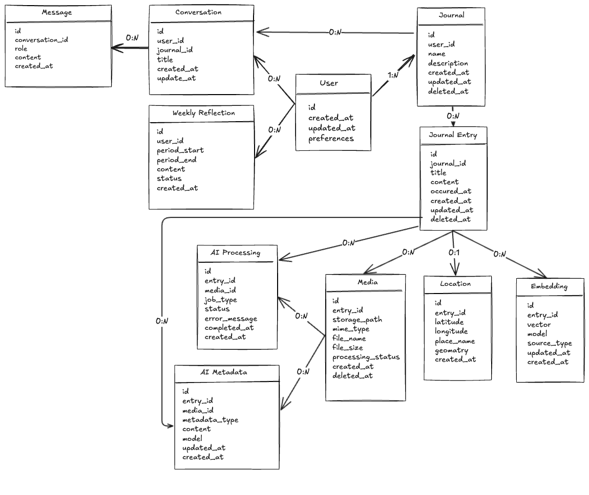

# JournalPilot — Data Model

**Project:** JournalPilot  
**Document:** Data Model  
**Version:** 1.0  
**Status:** Approved 
**Date:** October 2026  
**Author:** Kevin Pratama

---

## 1. Overview

JournalPilot uses PostgreSQL as the authoritative application data store for structured journal data, relationships, AI processing state, embeddings, and geospatial metadata.

Media binaries are stored separately in Supabase Storage. PostgreSQL stores the associated media metadata and storage reference.

The data model supports:

1. Personal journal and entry management.
2. Multimodal memories containing text, images, timestamps, and locations.
3. Asynchronous AI processing and derived memory representations.
4. Hybrid RAG using semantic, temporal, geospatial, and journal-scope retrieval.
5. Conversational AI grounded in the user's authorized memories.
6. Weekly AI-generated personal reflections.
7. Trash, recovery, and permanent deletion.

This document defines the logical domain model, relationships, ownership rules, lifecycle, and storage considerations. It does not define ORM migrations or implementation-specific SQL.

---

# 2. Data Modeling Principles

## 2.1 User-Owned Data

JournalPilot is a multi-tenant system. User-owned resources must always be associated with the authenticated user.

The server must derive the user identity from the authenticated request rather than trusting an arbitrary `user_id` supplied by the client.

## 2.2 Journal Ownership

Journals belong to users, and journal entries belong to journals.

```text
User
  ↓
Journal
  ↓
Journal Entry
```

All access to entries, media, locations, embeddings, conversations, and derived data must respect this ownership chain.

## 2.3 Original Data vs Derived Data

The original journal entry is the source of truth.

AI-generated information such as embeddings, image descriptions, image tags, and other AI metadata is derived data.

```text
Original Journal Entry
        ↓
   AI Processing
        ↓
  Derived Memory Data
```

If AI processing fails, the original journal entry remains available.

## 2.4 Media Separation

Raw image binaries are stored in Supabase Storage rather than PostgreSQL.

PostgreSQL stores metadata and a reference to the storage object.

```text
PostgreSQL
    │
    └── Media Metadata
          └── storage_path

Supabase Storage
    │
    └── Image Binary
```

## 2.5 Searchable Memory

A journal entry can become searchable through multiple representations:

```text
Journal Entry
 ├── Text
 ├── Timestamp
 ├── Location
 ├── Media
 └── AI-derived representations
       └── Embedding
```

---

# 3. Entity Overview

| Entity | Purpose | Primary Storage |
|---|---|---|
| User | Owner of personal JournalPilot data | Supabase Auth / PostgreSQL |
| Journal | Container for journal entries | PostgreSQL |
| Journal Entry | Core personal memory | PostgreSQL |
| Media | Metadata for images/files attached to entries | PostgreSQL |
| Location | Geospatial information associated with an entry | PostgreSQL + PostGIS |
| Embedding | Vector representation for semantic retrieval | PostgreSQL + pgvector |
| AI Processing | Persistent state for asynchronous AI processing | PostgreSQL |
| AI Metadata | AI-derived information about journal content/media | PostgreSQL |
| Weekly Reflection | Generated reflection over a time period | PostgreSQL |
| Conversation | AI chat session | PostgreSQL |
| Message | Individual user/assistant message | PostgreSQL |

Main relationship:

```text
User
 │
 ├── Journals
 │     │
 │     └── Journal Entries
 │           ├── Media
 │           ├── Location
 │           ├── Embeddings
 │           ├── AI Processing
 │           └── AI Metadata
 │
 ├── Conversations
 │     └── Messages
 │
 └── Weekly Reflections
```

---

# 4. Core Domain Entities

## 4.1 User

### Purpose

Represents the owner of JournalPilot data.

Authentication identity is managed through Supabase Auth. Application-specific user data may be stored in PostgreSQL when required.

### Key Attributes

| Field | Type | Required | Description |
|---|---|---|---|
| id | UUID | Yes | Unique user identifier |
| created_at | Timestamp | Yes | Account creation timestamp |
| updated_at | Timestamp | Yes | Last profile update |
| preferences | JSON/structured data | Optional | User-specific preferences when required |

### Relationships

- One user has many journals.
- One user has many conversations.
- One user has many weekly reflections.

---

## 4.2 Journal

### Purpose

Represents a logical collection of journal entries.

### Key Attributes

| Field | Type | Required | Description |
|---|---|---|---|
| id | UUID | Yes | Unique journal identifier |
| user_id | UUID | Yes | Owner of the journal |
| name | String | Yes | Journal name |
| description | Text | Optional | Journal description |
| created_at | Timestamp | Yes | Creation timestamp |
| updated_at | Timestamp | Yes | Last update timestamp |
| deleted_at | Timestamp | Optional | Soft-delete timestamp |

### Relationships

- Belongs to one user.
- Has many journal entries.

### Constraints

- `user_id` must reference an existing user.
- A user can only access their own journals.
- Deleted journals must not appear in normal active queries.

---

## 4.3 Journal Entry

### Purpose

Represents a single personal memory or journal entry.

The journal entry is the primary source of truth for the user's written experience.

### Key Attributes

| Field | Type | Required | Description |
|---|---|---|---|
| id | UUID | Yes | Unique entry identifier |
| journal_id | UUID | Yes | Parent journal |
| title | String | Optional | Entry title |
| content | Text / Rich Text | Yes | Journal content |
| occurred_at | Timestamp | Yes | Time the experience occurred |
| created_at | Timestamp | Yes | Record creation timestamp |
| updated_at | Timestamp | Yes | Last update timestamp |
| deleted_at | Timestamp | Optional | Soft-delete timestamp |

### Relationships

- Belongs to one journal.
- Has many media records.
- Has zero or one primary location record.
- Has derived embedding records when indexed.
- Has AI processing records.
- May have AI-generated metadata.

### Important Timestamp Distinction

`occurred_at` represents when the journal experience happened, while `created_at` represents when the database record was created.

This distinction is important for temporal retrieval.

---

## 4.4 Media

### Purpose

Represents metadata for media attached to a journal entry.

The raw media binary is stored in Supabase Storage.

### Key Attributes

| Field | Type | Required | Description |
|---|---|---|---|
| id | UUID | Yes | Unique media identifier |
| entry_id | UUID | Yes | Parent journal entry |
| storage_path | String | Yes | Path/reference to object storage |
| mime_type | String | Yes | Media MIME type |
| file_name | String | Optional | Original/display filename |
| file_size | Integer | Optional | File size |
| processing_status | Enum | Yes | AI processing state |
| created_at | Timestamp | Yes | Upload/record creation timestamp |
| deleted_at | Timestamp | Optional | Deletion timestamp |

### Relationships

- Belongs to one journal entry.
- May have AI-generated metadata.
- May have an associated embedding when represented semantically.

---

## 4.5 Location

### Purpose

Represents geospatial metadata associated with a journal entry.

Location is optional.

### Key Attributes

| Field | Type | Required | Description |
|---|---|---|---|
| id | UUID | Yes | Unique location identifier |
| entry_id | UUID | Yes | Associated journal entry |
| latitude | Numeric | Yes | Latitude |
| longitude | Numeric | Yes | Longitude |
| place_name | String | Optional | Human-readable place name |
| geometry | Geography/Geometry | Yes | PostGIS spatial representation |
| created_at | Timestamp | Yes | Record creation timestamp |

### Relationships

- Belongs to one journal entry.
- An entry can have zero or one primary location.

### Use

Location data supports city, proximity, place, and geospatial RAG queries.

---

# 5. AI & Memory Entities

## 5.1 Embedding

### Purpose

Represents a vector embedding used for semantic retrieval.

### Key Attributes

| Field | Type | Required | Description |
|---|---|---|---|
| id | UUID | Yes | Unique embedding identifier |
| entry_id | UUID | Yes | Source journal entry |
| vector | Vector | Yes | Embedding vector |
| model | String | Yes | Embedding model used |
| source_type | Enum | Yes | Content represented by the embedding |
| created_at | Timestamp | Yes | Generation timestamp |
| updated_at | Timestamp | Yes | Last regeneration timestamp |

### Storage

Embeddings are stored in PostgreSQL using pgvector.

```text
Journal Entry
      ↓
Embedding Model
      ↓
Vector
      ↓
pgvector
      ↓
Similarity Search
```

If source content or the embedding model changes, the embedding may need to be regenerated.

---

## 5.2 AI Processing

### Purpose

Tracks asynchronous processing performed on journal data.

Examples:

- Text embedding generation.
- Image analysis.
- Image description/tag generation.
- Memory indexing.
- Weekly reflection generation.

### Key Attributes

| Field | Type | Required | Description |
|---|---|---|---|
| id | UUID | Yes | Unique processing record |
| entry_id | UUID | Optional | Related entry |
| media_id | UUID | Optional | Related media |
| job_type | Enum | Yes | Type of AI processing |
| status | Enum | Yes | Current processing state |
| attempts | Integer | Yes | Number of attempts |
| error_message | Text | Optional | Failure information |
| started_at | Timestamp | Optional | Processing start |
| completed_at | Timestamp | Optional | Processing completion |
| created_at | Timestamp | Yes | Job record creation |

### Processing Lifecycle

```text
QUEUED
  ↓
PROCESSING
  ↓
COMPLETED
```

Failure:

```text
QUEUED
  ↓
PROCESSING
  ↓
FAILED
  ↓
RETRY
  ↓
PROCESSING
```

Redis/BullMQ manages active queue infrastructure. PostgreSQL can persist processing state that must remain visible to the application.

---

## 5.3 AI-Generated Metadata

### Purpose

Stores information derived from AI analysis of journal content or media.

Examples:

- Image descriptions.
- Image tags.
- Extracted semantic information.
- Other searchable AI-generated representations.

### Key Attributes

| Field | Type | Required | Description |
|---|---|---|---|
| id | UUID | Yes | Unique metadata identifier |
| entry_id | UUID | Optional | Related journal entry |
| media_id | UUID | Optional | Related media |
| metadata_type | Enum/String | Yes | Type of generated metadata |
| content | JSON/Text | Yes | Generated information |
| model | String | Yes | AI model used |
| created_at | Timestamp | Yes | Generation timestamp |
| updated_at | Timestamp | Yes | Last update |

AI-generated metadata is derived data and must not replace original journal content or media.

---

## 5.4 Weekly Reflection

### Purpose

Represents an AI-generated reflection over a defined period of journal activity.

### Key Attributes

| Field | Type | Required | Description |
|---|---|---|---|
| id | UUID | Yes | Unique reflection identifier |
| user_id | UUID | Yes | Reflection owner |
| period_start | Date | Yes | Start of reflection period |
| period_end | Date | Yes | End of reflection period |
| content | Text | Yes | Generated reflection |
| status | Enum | Yes | Generation state |
| created_at | Timestamp | Yes | Creation timestamp |

### Relationships

- Belongs to one user.
- Is generated from journal evidence within a defined period.

### Grounding

Weekly reflections must be grounded in retrieved journal entries and should not present unsupported speculation as fact.

---

# 6. Conversation Entities

## 6.1 Conversation

### Purpose

Represents an AI chat session in which the user asks questions about their memories.

### Key Attributes

| Field | Type | Required | Description |
|---|---|---|---|
| id | UUID | Yes | Unique conversation identifier |
| user_id | UUID | Yes | Conversation owner |
| journal_id | UUID | Optional | Journal scope when applicable |
| title | String | Optional | Conversation title |
| created_at | Timestamp | Yes | Creation timestamp |
| updated_at | Timestamp | Yes | Last activity |

### Relationships

- Belongs to one user.
- May be scoped to one journal.
- Has many messages.

---

## 6.2 Message

### Purpose

Represents an individual message within a conversation.

### Key Attributes

| Field | Type | Required | Description |
|---|---|---|---|
| id | UUID | Yes | Unique message identifier |
| conversation_id | UUID | Yes | Parent conversation |
| role | Enum | Yes | User or assistant |
| content | Text | Yes | Message content |
| created_at | Timestamp | Yes | Message timestamp |

### Relationships

- Belongs to one conversation.

Conversation history can provide query context for follow-up questions, but it must not override user or journal authorization.

---

# 7. Entity Relationships

## 7.1 Core Relationships

```text
User
 │
 │ 1:N
 ▼
Journal
 │
 │ 0:N
 ▼
Journal Entry
 │
 ├────────────── 0:N ──────────────► Media
 │
 ├────────────── 0:1 ──────────────► Location
 │
 ├────────────── 0:N ──────────────► Embedding
 │
 ├────────────── 0:N ──────────────► AI Processing
 │
 └────────────── 0:N ──────────────► AI Metadata
```

## 7.2 Conversation Relationships

```text
User
 │
 │ 0:N
 ▼
Conversation
 │
 │ 0:N
 ▼
Message

Journal
 │
 │ 0:N
 ▼
Conversation
```

## 7.3 AI Processing Relationship
```text
Journal Entry
 ├── 0:N → AI Processing
 └── 0:N → AI Metadata

Media
 ├── 0:N → AI Processing
 └── 0:N → AI Metadata
```

## 7.4 Reflection Relationship

```text
User
 │
 │ 0:N
 ▼
Weekly Reflection
```

## 7.5 Overall Domain Model

```text
                          ┌──────────────┐
                          │     User     │
                          └──────┬───────┘
                                 │
              ┌──────────────────┼──────────────────┐
              │                  │                  │
              ▼                  ▼                  ▼
         ┌──────────┐     ┌──────────────┐   ┌──────────────────┐
         │  Journal │     │ Conversation │   │ Weekly Reflection│
         └────┬─────┘     └──────┬───────┘   └──────────────────┘
              │                  │
              │                  ▼
              │             ┌──────────┐
              │             │ Message  │
              │             └──────────┘
              │
              ├──────── 0:N ────────► Conversation
              │
              ▼
       ┌───────────────┐
       │ Journal Entry │
       └───────┬───────┘
               │
       ┌───────┼───────────────┬───────────────┐
       │       │               │               │
       ▼       ▼               ▼               ▼
     Media  Location       Embedding      AI Processing

Journal Entry ── 0:N ──► AI Processing
Journal Entry ── 0:N ──► AI Metadata
Media         ── 0:N ──► AI Processing
Media         ── 0:N ──► AI Metadata
```

# 8. Multi-Tenancy & Data Isolation

JournalPilot must enforce data isolation at the application and data-access boundaries.

## 8.1 Ownership Chain

```text
Authenticated User
       ↓
     Journal
       ↓
     Entry
       ↓
 ┌─────┼────────┬─────────┐
 ▼     ▼        ▼         ▼
Media Location Embedding AI Data
```

Derived data must inherit the authorization scope of its source data.

## 8.2 Authorization Rule

The server must resolve the authenticated user's identity from the authentication context.

```text
Request
  ↓
Authenticated User
  ↓
Resolve User Identity
  ↓
Check Journal Ownership
  ↓
Access Resource
```

## 8.3 RAG Isolation

The vector store must not be treated as a globally searchable memory pool.

Retrieval must remain scoped to the authenticated user and any selected journal scope.

```text
Query
 ↓
Authenticated User Scope
 ↓
Journal Scope
 ↓
Semantic / Time / Location Retrieval
 ↓
Authorized Memories
```

A semantic match belonging to another user must never enter the RAG context.

---

# 9. Data Lifecycle

## 9.1 Journal Entry Lifecycle

```text
CREATE
  ↓
ACTIVE
  ↓
UPDATED
  ↓
TRASHED
  ├──────────────► RESTORED
  │                    │
  │                    └──────► ACTIVE
  │
  ▼
PERMANENTLY DELETED
```

## 9.2 AI Processing Lifecycle

```text
Entry Created
      ↓
Processing Job Queued
      ↓
Processing
      ↓
Derived Data Generated
      ↓
Memory Searchable
```

If processing fails:

```text
Entry Created
      ↓
Processing Job
      ↓
FAILED
      ↓
Retry
```

AI processing failure does not invalidate the original journal entry.

## 9.3 Permanent Deletion

Permanent deletion should remove relevant:

- Journal data.
- Media metadata.
- Storage objects.
- Embeddings.
- AI-generated metadata.
- Processing state.
- Other associated derived artifacts.

Exact cascading behavior should be finalized during implementation.

---

# 10. RAG Data Model

JournalPilot's RAG system relies on several complementary representations of a memory.

## 10.1 Semantic Representation

```text
Journal Entry
      ↓
Embedding Model
      ↓
Vector
      ↓
pgvector
```

## 10.2 Temporal Representation

Each journal entry stores the time associated with the experience.

```text
Journal Entry
      ↓
occurred_at
      ↓
Temporal Filter
```

`occurred_at` supports queries such as:

- "last week"
- "last month"
- "during September"
- "before my internship"

## 10.3 Geospatial Representation

```text
Journal Entry
      ↓
Location
      ↓
PostGIS
      ↓
Spatial Query
```

## 10.4 Journal Scope

```text
User
 ↓
Journal
 ↓
Entry
```

Journal scope can restrict retrieval to the authenticated user's selected journal or journals.

## 10.5 Combined Memory Representation

```text
                         Journal Entry
                              │
             ┌────────────────┼────────────────┐
             │                │                │
             ▼                ▼                ▼
         Semantic          Temporal        Geospatial
         pgvector          occurred_at       PostGIS
             │                │                │
             └────────────────┼────────────────┘
                              │
                       Journal Scope
                              │
                              ▼
                       Hybrid Retrieval
```

The original journal entry remains the source of truth while these representations provide different retrieval dimensions.

---

# 11. Storage & Indexing

## 11.1 Storage Responsibilities

| Data | Storage |
|---|---|
| Authentication identity | Supabase Auth |
| Application user data | PostgreSQL |
| Journals | PostgreSQL |
| Journal entries | PostgreSQL |
| Media metadata | PostgreSQL |
| Image binaries | Supabase Storage |
| Embeddings | PostgreSQL + pgvector |
| Geospatial data | PostgreSQL + PostGIS |
| Conversations | PostgreSQL |
| Messages | PostgreSQL |
| Weekly reflections | PostgreSQL |
| Persistent AI processing state | PostgreSQL |
| Queue infrastructure | Redis + BullMQ |

PostgreSQL remains the authoritative application data store. Redis is infrastructure for asynchronous processing and is not the source of truth for journal data.

## 11.2 Indexing Considerations

The implementation should provide indexes for common access patterns, including:

- User-owned journals.
- Journal entries by `journal_id`.
- Journal entries by `occurred_at`.
- Active/deleted records.
- Media by `entry_id`.
- Processing records by status.
- Conversations by `user_id`.
- Messages by `conversation_id`.
- Geospatial queries through appropriate PostGIS indexes.
- Vector similarity queries through appropriate pgvector indexing when required by scale.

Exact index types and configuration should be determined during implementation based on measured query behavior.

---

# 12. Data Integrity & Constraints

## 12.1 Relationship Constraints

Core relationships must enforce valid ownership and references.

```text
Journal.user_id
    → User.id

JournalEntry.journal_id
    → Journal.id

Media.entry_id
    → JournalEntry.id

Location.entry_id
    → JournalEntry.id

Embedding.entry_id
    → JournalEntry.id

Conversation.user_id
    → User.id

Conversation.journal_id
    → Journal.id (optional)

Message.conversation_id
    → Conversation.id

WeeklyReflection.user_id
    → User.id

AIProcessing.entry_id
    → JournalEntry.id (optional)

AIProcessing.media_id
    → Media.id (optional)

AIMetadata.entry_id
    → JournalEntry.id (optional)

AIMetadata.media_id
    → Media.id (optional)
```

## 12.2 Required Data

A valid journal entry should not depend on AI processing.

At minimum:

```text
Journal Entry
 ├── journal_id
 ├── content
 ├── occurred_at
 └── timestamps
```

Media, location, and AI-derived data are optional from the perspective of the original entry.

## 12.3 Processing State

AI processing states should be constrained to known states such as:

```text
QUEUED
PROCESSING
COMPLETED
FAILED
```

## 12.4 Deletion Integrity

Deleting a parent entity must not leave inaccessible or unintended orphaned data.

The implementation must define appropriate behavior for:

- Journal → Entries
- Entry → Media
- Entry → Embeddings
- Entry → AI Metadata
- Conversation → Messages

Media stored in Supabase Storage must also be reconciled with database deletion.

---

# 13. Data Model Diagram

The logical ERD for the initial MVP is:



This represents the logical domain model. Physical implementation may introduce additional tables or fields where required.

---

# 14. Future Considerations

The MVP data model should remain extensible without implementing future requirements prematurely.

Potential future extensions include:

- Voice journal media and speech-to-text metadata.
- Mobile-specific metadata where required.
- Advanced analytics.
- More sophisticated retrieval and reranking data.
- Additional AI agent state.
- Local/on-device AI representations.
- Dedicated vector infrastructure if PostgreSQL becomes insufficient.

Future entities should only be introduced when a concrete product or engineering requirement justifies them.
